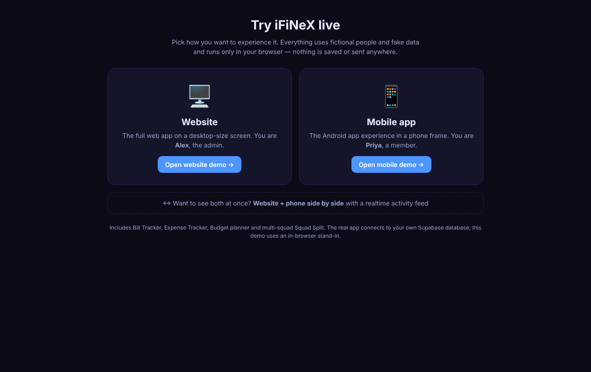
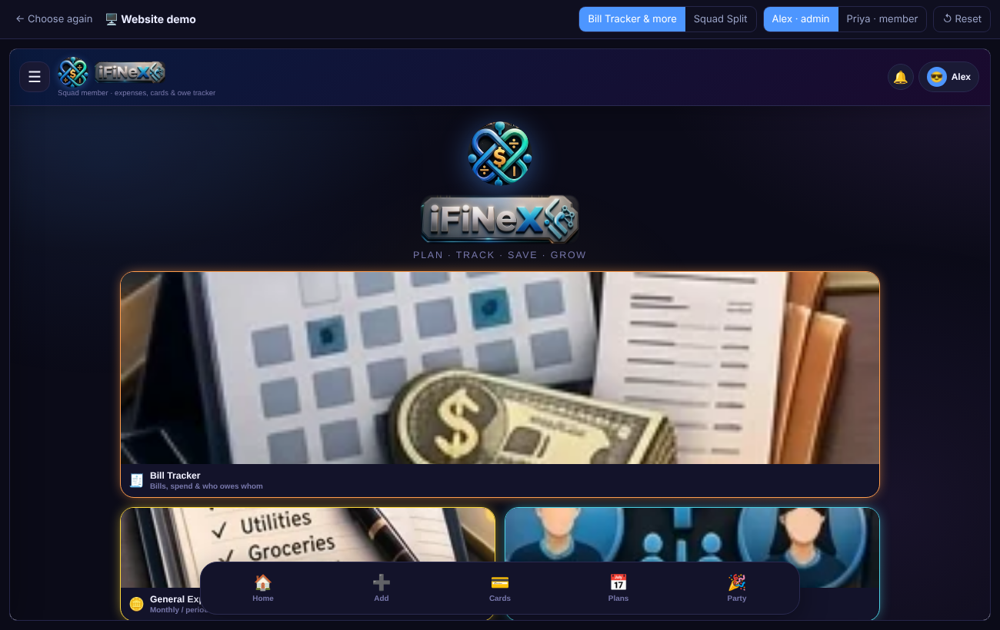
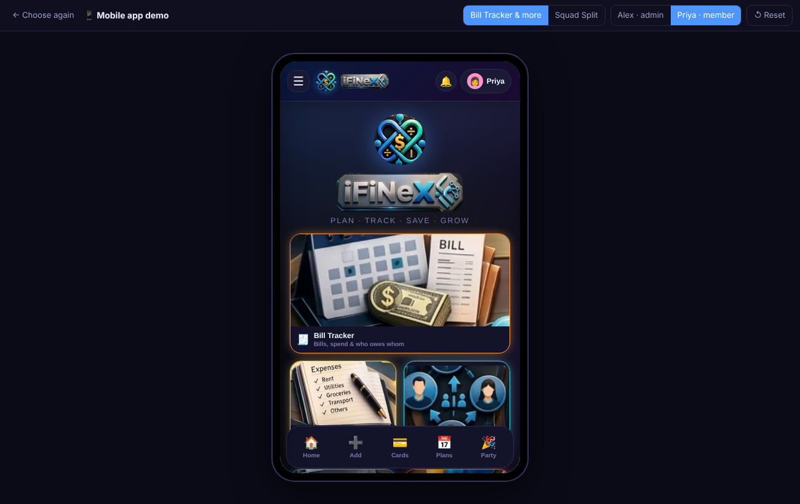

# iFiNeX — shared expenses, bills, cards, trackers & budgets (open source)

One codebase, two ways to run:

| Mode | What it is | Needs a server? |
|---|---|---|
| **Standalone** | Everything is stored in your own browser / phone. Single user. | No |
| **Server** | Many users, e-mail-code login, live sync between website and phone app, shared Squad Split. | Yes — a Supabase backend you own |

Website = `web/` (plain HTML/JS, host anywhere static, e.g. GitHub Pages). Android/iOS = `mobile/` (Capacitor wrapper around the same website). Database = `supabase/schema.sql`.

**No real data, keys or URLs are in this repository.** You bring your own backend.

## Live demo
<p align="center"></p>

After you publish the demo (see `docs/10-LIVE-DEMO.md`, 5 minutes) your repository gets a **Live demo** link at `[https://<your-user>.github.io/<repo>/](https://squadsplit.github.io/iFiNeX-Demo/)`. Visitors choose **Website** or **Mobile app** (or both side by side); everything uses fictional data in the browser, no backend.

<p align="center"> </p>

Run it locally: `bash demo/build-demo.sh` then `python3 -m http.server -d demo/dist 8181` and open http://localhost:8181 .

## Pick your path
| I want… | Read |
|---|---|
| Quickest: hosted Supabase (free tier) | `docs/01-SUPABASE-CLOUD.md` |
| Everything on my own server (Docker) | `docs/02-SUPABASE-SELF-HOSTED-DOCKER.md` |
| Plain PostgreSQL I already run | `docs/03-PLAIN-POSTGRES.md` |
| MySQL / MariaDB / SQL Server | `docs/04-MYSQL-MSSQL.md` (read this — it is an honest "not directly") |
| Single user, no server | `docs/05-STANDALONE-MODE.md` |
| Publish the website | `docs/06-GITHUB-PAGES.md` |
| Build the Android app | `docs/07-ANDROID.md` |
| Lock it down before real users | `docs/08-SECURITY-CHECKLIST.md` · `docs/09-TRAFFIC-AND-LIMITS.md` |
| Put a live demo link on my repo page | `docs/10-LIVE-DEMO.md` |

## Layout
```
web/       website (+ ifinex-config.example.json)
mobile/    Capacitor Android + iOS projects (mobile/www is a copy of web/, refresh with tools/sync-www.sh)
supabase/  schema.sql (tables, RLS, functions)  ·  hardening.sql (already included in schema.sql; for upgrading old installs)
demo/      live demo (chooser: website / mobile / both)
docs/      guides      .github/workflows/  deploy-web · deploy-demo · android-build
```
License: MIT (see LICENSE). Security: see SECURITY.md.
