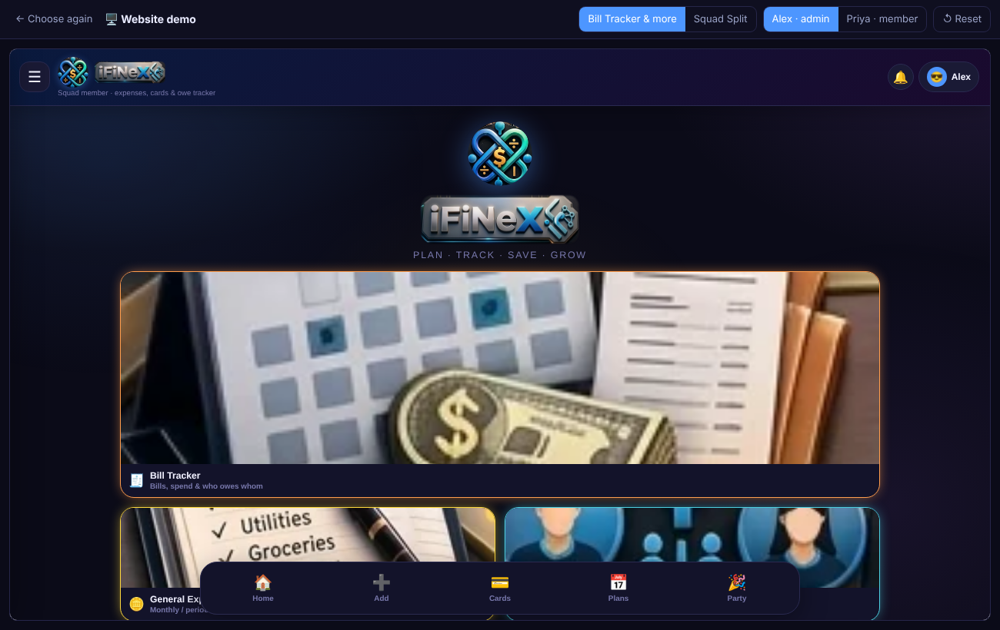
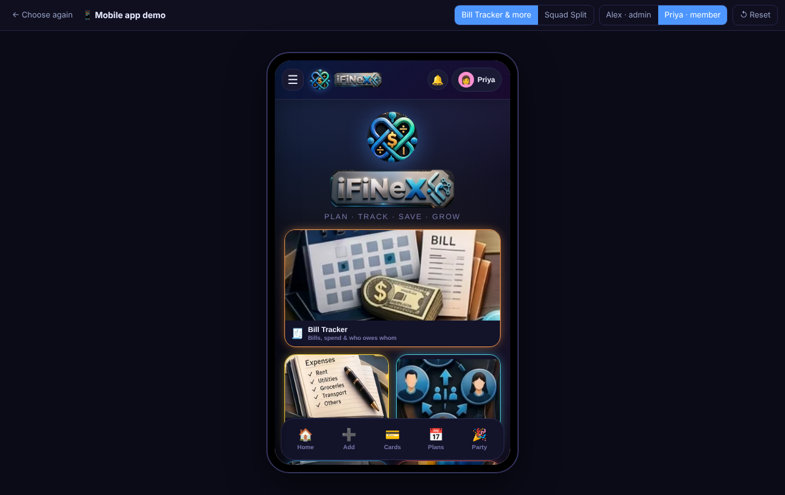

# iFiNeX — shared expenses, bills, cards, trackers & budgets (open source)

One codebase, two ways to run:

| Mode | What it is | Needs a server? |
|---|---|---|
| **Standalone** | Everything is stored in your own browser / phone. Single user. | No |
| **Server** | Many users, e-mail-code login, live sync between website and phone app, shared Squad Split. | Yes — a Supabase backend you own |

Website = `web/` (plain HTML/JS, host anywhere static, e.g. GitHub Pages). Android/iOS = `mobile/` (Capacitor wrapper around the same website). Database = `supabase/schema.sql`.

**No real data, keys or URLs are in this repository.** You bring your own backend.

## Live demo
<p align="center"></p>

After you publish the demo (see `docs/10-LIVE-DEMO.md`, 5 minutes) your repository gets a **Live demo** link at `https://<your-user>.github.io/<repo>/`. It is a full explainer page, not just a preview:

- **Choose Website or Mobile app** on the first screen (or both side by side).
- **18 guided walkthroughs** — each opens the right screen for the right person (admin, member, delegate) and tells you what to try.
- **Request Inspector** — shows every database call the app makes (table, filter, payload) and why the database allows it.
- **Searchable guide to every option and function** (77 entries), a **database explorer** (34 tables + server functions), key flows, roles table and honest limits.
- Includes a clearly labelled **simulated Google Drive** connect / schedule / back-up / restore flow.

Everything uses fictional people and fake data in the browser — no backend.

<p align="center"> </p>
<p align="center"> </p>

Run it locally: `bash demo/build-demo.sh` then `python3 -m http.server -d demo/dist 8181` and open http://localhost:8181 .

## Pick your path
| I want… | Read |
|---|---|
| Quickest: hosted Supabase (free tier) | `docs/01-SUPABASE-CLOUD.md` |
| Everything on my own server (Docker) | `docs/02-SUPABASE-SELF-HOSTED-DOCKER.md` |
| Plain PostgreSQL I already run | `docs/03-PLAIN-POSTGRES.md` |
| MySQL / MariaDB / SQL Server | `docs/04-MYSQL-MSSQL.md` (read this — it is an honest "not directly") |
| Single user, no server | `docs/05-STANDALONE-MODE.md` |
| Publish the website | `docs/06-GITHUB-PAGES.md` |
| Build the Android app | `docs/07-ANDROID.md` |
| Lock it down before real users | `docs/08-SECURITY-CHECKLIST.md` · `docs/09-TRAFFIC-AND-LIMITS.md` |
| Put a live demo link on my repo page | `docs/10-LIVE-DEMO.md` |

## Layout
```
web/       website (+ ifinex-config.example.json)
mobile/    Capacitor Android + iOS projects (mobile/www is a copy of web/, refresh with tools/sync-www.sh)
supabase/  schema.sql (tables, RLS, functions)  ·  hardening.sql (already included in schema.sql; for upgrading old installs)
demo/      live demo (chooser: website / mobile / both)
docs/      guides      .github/workflows/  deploy-web · deploy-demo · android-build
```
License: MIT (see LICENSE). Security: see SECURITY.md.

## What's new in v9.8
Mark as completed / Reopen / Edit / Delete (⋯ menu) and an Active · Completed · All area in the Expense Tracker, EPP & Gold plans and Budget planner; month / custom date / category filters; automatic move to Completed (nightly `ifx_auto_complete()`); faster saving; Android app 2.12.0 no longer requests install/battery permissions (no install-permission warning). Database: run `supabase/schema.sql` on a new project (already includes v9.8).

## What's new in v9.9
**Report Center** in Bill Tracker and Squad Split: monthly / last 3 months / year / all time / one month / custom dates; my account, all users or chosen users (admins & delegates); chosen squad members and squads; one section per user, combined table or monthly summary; PDF, Excel and CSV. **Download fix:** files now go through Android's share sheet (the old browser-style download was ignored by the app's WebView) and every export in the app uses the same safe saver. No database change (still v9.8).

## Versioning
Major number = a release with new features (web 10, app 3, …). Minor number = small fixes only. v10.0 / app 3.0.0 contains everything from v9.8–v9.10: Completed lifecycle + filters, faster saving, Report Center + working downloads, in-app updater.

## What's new in v13.1 (web 13.1 / app 6.0.1) — GitHub build fix
* **Fixed `npm ci` failing in GitHub Actions** ("lock file's minipass@6.0.0 does not satisfy minipass@5.0.0"). My version-bump command since v12.1 also rewrote one dependency (`tar`'s `minipass`) that happened to have the same version number as the app. `package-lock.json` is restored; it was the ONLY dependency touched. Version bumps are now done on the root version only, and the build script runs `npm ci --dry-run` before packaging.

## What's new in v13.0 (web 13.0 / app 6.0.0) — choose who, direction and report type
* **With whom:** pick Everyone or tick specific people (e.g. only Kaatuva, or Kaatuva + Naina) for the statement of the chosen account(s).
* **Direction:** tick "what they owe the account" and/or "what the account owes them".
* **Report type is now two checkboxes:** Balances and/or Full breakdown (breakdown alone is allowed).
* **Grand total is clearer:** "TOTAL OWED TO <you>" and "TOTAL <you> OWES" are separate lines; the NET only appears when both exist. Example: others owe Abdullah 3,898.43 — it is no longer silently reduced by what he owes someone else.
* Mobile layout: long TOTAL labels span the table instead of wrapping in one narrow cell.

## What's new in v12.2 (web 12.2 / app 5.1.1) — correct, readable statement
* **Squad Split now matches the Squad page** (all expenses + carried balances − settlements, then the same "simplify" netting). Before, the report only looked inside single months and showed 0 for someone who owes 547.
* **Who pays whom:** one column per person ("To pay Abdullah", "To pay Naina" …), one row per module, TOTAL TO PAY.
* **One block per person**, months **newest first** (opening + new charges − paid = closing), ending with "X NEEDS TO PAY Y — TOTAL"; the **GRAND TOTAL is always the last table**.
* Full breakdown: every entry newest first with a running balance; a "Squad netting" line explains the difference to a one-to-one ledger.
* PDF: no more broken characters (arrows / minus), bold headings, right-aligned numbers.

## What's new in v12.1 (web 12.1 / app 5.1.0) — Play Protect fix
* The GitHub workflow built a **debug** APK (`assembleDebug`, debuggable=true) and published it. Google Play Protect treats debuggable, side-loaded APKs that can install other APKs as high risk ("Harmful app blocked"). The workflow now builds `assembleRelease` (debuggable=false) signed with the SAME permanent key, so updates still install over the old app.
* `build.gradle` release type: `debuggable false`, uses the iFiNeX key (fallback: debug key only when no key exists).

## What's new in v12.0 (app 5.0.0)
**Statements that say who pays whom** — every module now has its own 📊 report button (Bill Tracker, Party ledger, Squad Split, EPP & Gold plans, Shared card payments, Expense / Event / Trip trackers, Budget planner) and the Hub has the all-modules one. One simple window: **1 Duration** (Weekly · Monthly · All time · Custom) · **2 Modules** (tick boxes) · **3 Users** · **4 Report type**. *Balances only* = TOTAL TO PAY per person (Squad Split + Bill Tracker + EPP & Gold together), OWED TO YOU, Paid so far (to whom, how much, when) and a month-by-month balance (brought forward + new charges − paid = closing). *Full breakdown* adds every share, settlement, carried-forward balance, party entry, instalment, spending line and card due. Output: preview · PDF · Excel · CSV. Read-only, no database change. Supabase "disk IO budget" e-mail investigated: the database is idle (18 MB, ~1 checkpoint buffer per run); see the reference file section W.

## What's new in v11.0 (app 4.0.0)
**Hub report for every module** — 📊 Reports & Downloads on the Hub: Bill Tracker, Squad Split, Expense / Trip / Event trackers (all or one chosen trip/event), Budget planner and EPP & Gold plans; month, custom dates, users; month-by-month overview; preview, PDF, Excel, CSV. No database change.
